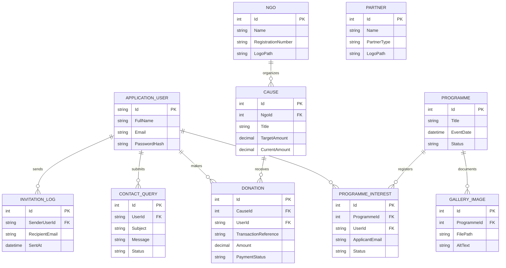

# Give-AID — Initial Data Requirements & Entity Analysis

**Document ID:** `DOC-06`  
**Project Name:** Give-AID — NGO Management & Donation Website  
**Status:** Approved for Task 1 Requirements Baseline  
**Date:** October 2026  

---

## 1. Scope & Purpose of Data Analysis

This document identifies the conceptual domain entities, logical attributes, business rules, and relational associations required to support the Give-AID platform. 

> [!IMPORTANT]
> **Strict Non-Implementation Notice:**  
> This document specifies **conceptual requirements only**. In strict compliance with Task 1 rules, no database tables, SQL scripts, Entity Framework Core models, or migration files are created at this stage. Physical schema creation is reserved for Task 6.

---

## 2. Identified Conceptual Entities

Based exclusively on the functional requirements and project task files, the system requires the following core entities:

### 2.1 Entity: `ApplicationUser` (Identity User)
- **Conceptual Purpose:** Represents registered human actors (members and administrators) managed by ASP.NET Core Identity.
- **Key Attributes:**
  - `Id` (Unique String / GUID, Primary Key)
  - `FullName` (Required text, donor/admin display name)
  - `Email` (Required unique text, login identifier)
  - `NormalizedEmail` (Identity indexed lookup)
  - `PasswordHash` (Secure PBKDF2 hash, never plaintext)
  - `PhoneNumber` (Optional contact number)
  - `CreatedAt` (Timestamp of registration)
  - `IsActive` (Boolean status flag)
- **Relationships:**
  - One-to-Many with `Donation` (One user can have multiple donations).
  - One-to-Many with `ProgrammeInterest` (One user can submit multiple volunteer/interest requests).
  - One-to-Many with `ContactQuery` (Optional: queries submitted while signed in).
  - Many-to-Many with `IdentityRole` (via standard Identity user-role mapping: `Admin`, `User`).

---

### 2.2 Entity: `NGO`
- **Conceptual Purpose:** Represents non-governmental organizations affiliated with the Give-AID platform.
- **Key Attributes:**
  - `Id` (Unique Integer, Primary Key)
  - `Name` (Required text, organization title)
  - `RegistrationNumber` (Text, official government registration)
  - `Description` / `Mission` (Detailed text)
  - `Address` (Text location)
  - `Email` (Contact email)
  - `Phone` (Contact telephone)
  - `WebsiteUrl` (Optional website URL)
  - `LogoPath` (Sanitized relative file path to stored logo image)
  - `IsActive` (Boolean status flag)
  - `CreatedAt` (Timestamp)
- **Relationships:**
  - One-to-Many with `Cause` (One NGO can manage multiple charitable causes).

---

### 2.3 Entity: `Partner`
- **Conceptual Purpose:** Represents corporate sponsors, donors, and institutional supporting partners.
- **Key Attributes:**
  - `Id` (Unique Integer, Primary Key)
  - `Name` (Required text, corporate or partner name)
  - `PartnerType` (Text or Enum: e.g., Corporate Sponsor, Community Partner, Media Partner)
  - `Description` (Text summary)
  - `WebsiteUrl` (External URL)
  - `LogoPath` (Sanitized relative file path to stored logo)
  - `DisplayOrder` (Integer for homepage ordering)
  - `IsActive` (Boolean status flag)
- **Relationships:**
  - Independent entity showcased on homepage and partner directory.

---

### 2.4 Entity: `Cause`
- **Conceptual Purpose:** Represents a specific charitable fundraising drive or humanitarian cause.
- **Key Attributes:**
  - `Id` (Unique Integer, Primary Key)
  - `Title` (Required text, cause headline)
  - `ShortDescription` (Brief summary for cards and lists)
  - `FullDescription` (Comprehensive narrative)
  - `TargetAmount` (Decimal, fundraising financial goal)
  - `CurrentAmount` (Decimal, cumulative funds mobilized)
  - `ImagePath` (Sanitized relative path to campaign photo)
  - `NgoId` (Foreign Key referencing `NGO`)
  - `IsFeatured` (Boolean flag for homepage prominence)
  - `IsActive` (Boolean status flag)
  - `StartDate` / `EndDate` (Date range for campaign)
  - `CreatedAt` (Timestamp)
- **Relationships:**
  - Many-to-One with `NGO` (Each cause belongs to an NGO).
  - One-to-Many with `Donation` (One cause receives multiple donations).

---

### 2.5 Entity: `Donation`
- **Conceptual Purpose:** Records simulated donor contributions, maintaining financial auditability without handling real card data.
- **Key Attributes:**
  - `Id` (Unique Integer, Primary Key)
  - `TransactionReference` (Unique non-sensitive string, e.g., `REF-DEMO-20261013-0001`)
  - `Amount` (Decimal, strictly positive value)
  - `DonationDate` (UTC Timestamp)
  - `DonorName` (Required text, donor name)
  - `DonorEmail` (Required email for digital receipt delivery)
  - `DonorPhone` (Optional contact number)
  - `PaymentStatus` (Text or Enum: `Completed`, `Failed`, `Pending`)
  - `IsSimulated` (Boolean flag, explicitly true)
  - `UserId` (Optional Foreign Key referencing `ApplicationUser`; null for guest donations)
  - `CauseId` (Foreign Key referencing `Cause`)
- **Relationships:**
  - Many-to-One with `Cause` (Every donation targets a specific cause).
  - Many-to-One (Optional) with `ApplicationUser` (Can be linked to registered member).

---

### 2.6 Entity: `Programme`
- **Conceptual Purpose:** Represents community welfare events, medical camps, educational drives, and relief initiatives.
- **Key Attributes:**
  - `Id` (Unique Integer, Primary Key)
  - `Title` (Required text, event name)
  - `Description` (Text event details and objectives)
  - `EventDate` (DateTime, used to determine Upcoming vs. Past status)
  - `Location` (Text venue or city)
  - `CoordinatorName` (Text, lead organizer)
  - `CoordinatorContact` (Contact number/email)
  - `BannerImagePath` (Sanitized relative path to event photo)
  - `Status` (Text or Enum: `Scheduled`, `Completed`, `Cancelled`)
  - `CreatedAt` (Timestamp)
- **Relationships:**
  - One-to-Many with `ProgrammeInterest` (Multiple users can register interest in an event).
  - One-to-Many with `GalleryImage` (Multiple gallery photos can be tagged with a programme).

---

### 2.7 Entity: `ProgrammeInterest`
- **Conceptual Purpose:** Records a user's expression of interest or volunteer application for an upcoming programme.
- **Key Attributes:**
  - `Id` (Unique Integer, Primary Key)
  - `ProgrammeId` (Foreign Key referencing `Programme`)
  - `UserId` (Optional Foreign Key referencing `ApplicationUser`)
  - `ApplicantName` (Required text)
  - `ApplicantEmail` (Required email)
  - `ApplicantPhone` (Required telephone)
  - `VolunteerNote` (Optional text description of skills/availability)
  - `Status` (Text or Enum: `Submitted`, `Approved`, `Declined`, `Attended`)
  - `SubmissionDate` (UTC Timestamp)
- **Relationships:**
  - Many-to-One with `Programme`.
  - Many-to-One (Optional) with `ApplicationUser`.
- **Integrity Constraint:**
  - Unique composite index on `(ProgrammeId, ApplicantEmail)` or `(ProgrammeId, UserId)` to prevent duplicate registrations.

---

### 2.8 Entity: `GalleryImage`
- **Conceptual Purpose:** Stores photographic evidence of relief activities, events, and community impact.
- **Key Attributes:**
  - `Id` (Unique Integer, Primary Key)
  - `Title` (Text title)
  - `Caption` (Text description)
  - `AltText` (Required accessibility text description)
  - `FilePath` (Sanitized relative storage path in `wwwroot/uploads/gallery/`)
  - `UploadedAt` (UTC Timestamp)
  - `ProgrammeId` (Optional Foreign Key referencing `Programme`)
- **Relationships:**
  - Many-to-One (Optional) with `Programme` (An image can link to a specific event or be general).

---

### 2.9 Entity: `ContactQuery`
- **Conceptual Purpose:** Captures inquiries, feedback, and help requests submitted via the Contact Us form.
- **Key Attributes:**
  - `Id` (Unique Integer, Primary Key)
  - `SenderName` (Required text)
  - `SenderEmail` (Required valid email)
  - `SenderPhone` (Optional contact number)
  - `Subject` (Required text)
  - `Message` (Required detailed message text)
  - `SubmittedAt` (UTC Timestamp)
  - `Status` (Text or Enum: `New`, `Reviewed`, `Replied`, `Closed`)
  - `AdminNotes` (Optional internal administrator comments)
  - `UserId` (Optional Foreign Key referencing `ApplicationUser`)
- **Relationships:**
  - Many-to-One (Optional) with `ApplicationUser`.

---

### 2.10 Entity: `InvitationLog`
- **Conceptual Purpose:** Tracks friend referrals and invitation activity while protecting privacy and throttling spam.
- **Key Attributes:**
  - `Id` (Unique Integer, Primary Key)
  - `SenderUserId` (Foreign Key referencing `ApplicationUser`)
  - `RecipientEmail` (Required email)
  - `SentAt` (UTC Timestamp)
  - `DeliveryStatus` (Text or Enum: `Logged`, `Sent`, `Failed`)
- **Relationships:**
  - Many-to-One with `ApplicationUser`.

---

## 3. High-Level Conceptual Entity-Relationship Diagram

---

## 4. Verification Note

All 10 conceptual entities correspond directly to explicit user stories in the Give-AID roadmap tasks. No unneeded or extraneous tables have been planned. Entity Framework Core data configurations and migrations will be implemented during **Task 6**.
